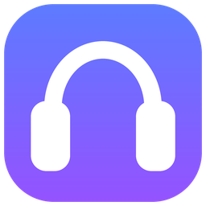

<p align="center">
  
</p>

<h1 align="center">Mini Soundpad</h1>

<p align="center">
  A free, open-source soundboard for Windows. Play sound effects with hotkeys, and the people in Discord, games and meetings hear them too.
  <br/>
  <b>English</b> · <a href="README.zh-CN.md">简体中文</a>
</p>

---

## Features

- 🎧 **Dual output**: sounds play in your headphones *and* into a **virtual microphone**, each with its own volume
- 🎙 **Mic passthrough**: your real mic is mixed into the virtual mic, so you can keep talking normally
- ⌨️ **Global hotkeys**: work in the background and inside games. Pressing the same key again restarts the sound
- 🔀 **Hotkey browsing**: step through your sounds with hotkeys (with a short preview only you can hear), then play the selected one, without alt-tabbing
- 📁 **Sound library**: drag in files or whole folders; rename, categorize, search, per-sound volume
- ⏺ **Record / loopback capture**: record from your mic, or capture what your PC is playing (a line from a video, say)
- ✂️ **Trim**: drag a selection on the waveform, preview, and save as a new file (the original is never touched)
- 🖥 **System tray**: closing the window keeps it running in the tray
- Supports wav / mp3 / m4a / aac / flac / wma / mp4

## Getting started

### 1. Install VB-Audio Virtual Cable (free)

Download it from <https://vb-audio.com/Cable/>, unzip, **right-click `VBCABLE_Setup_x64.exe` → Run as administrator** → Install Driver → **reboot**.

> ⚠️ After installing, Windows may switch your default playback device to "CABLE Input", so you hear nothing. Click the 🔊 icon in the taskbar and switch the output back to your headphones/speakers.

### 2. Download Mini Soundpad

Grab the latest `MiniSoundpad-vX.Y.Z-win-x64.zip` from [**Releases**](../../releases/latest), unzip it, and double-click `MiniSoundpad.exe`. No .NET install needed.

> On first launch Windows SmartScreen may say "Windows protected your PC" because the exe isn't code-signed. Click **More info → Run anyway**.

### 3. Set up Discord (or any voice app)

User Settings → Voice & Video:
- **Input Device**: **CABLE Output (VB-Audio Virtual Cable)**
- Turn off **Noise Suppression (Krisp)**, **Echo Cancellation** and **Automatic Gain Control**, or your sounds may get filtered out as noise
- Turn off "Automatically determine input sensitivity" and drag the slider all the way left

Then in Mini Soundpad's ⚙ Settings, pick your headphones under "自己听（耳机）" (monitor output), your microphone under "真实麦克风" (real mic), and enable "麦克风直通" (mic passthrough).

> Keep Mini Soundpad running (the tray is fine) while you're in voice chat, otherwise others won't hear you.

> The app's interface is currently in Chinese. Translations are welcome!

## Default hotkeys

| Action | Hotkey |
|---|---|
| Stop all | `Pause` |
| Select previous sound | `Ctrl+Alt+PageUp` |
| Select next sound | `Ctrl+Alt+PageDown` |
| Play selected sound | `Ctrl+Alt+Home` |
| Hotkey for a specific sound | right-click the sound → 设置快捷键… |

All of them can be changed in ⚙ Settings. Global hotkeys are captured exclusively by the app, so avoid single letter keys; `Ctrl+Alt+<number>`, numpad keys or `F13–F24` work well.

## How it works

```
sound ──┬──► [monitor mixer] ──► your headphones                 (you hear it)
        └──► [cable mixer]   ──► CABLE Input ─► CABLE Output ─► Discord / game
                  ▲
real mic ─────────┘ (mic passthrough)
```

Sounds are decoded to 48 kHz stereo float in memory when added, so triggering is near-instant; the same buffer feeds both mixers. Audio is built on [NAudio](https://github.com/naudio/NAudio) (WASAPI).

## Building from source

Requires the [.NET 8 SDK](https://dotnet.microsoft.com/download/dotnet/8.0).

```powershell
git clone https://github.com/cywang06/MiniSoundpad.git
cd MiniSoundpad
dotnet run
```

Single-file exe:

```powershell
dotnet publish -c Release -r win-x64 --self-contained true -p:PublishSingleFile=true -o publish
```

### Project layout

```
Audio/
  AudioEngine.cs     core: two mixers (monitor / virtual cable) + mic passthrough
  CachedSound.cs     in-memory decoded audio + Voice (one playback)
  AudioUtil.cs       format conversion, resampling, device lookup, VB-Cable detection
  Recorder.cs        mic recording / WASAPI loopback capture
Services/
  HotkeyManager.cs   global hotkeys via Win32 RegisterHotKey
  TrayIcon.cs        system tray icon
  Storage.cs         JSON persistence (%AppData%\MiniSoundpad)
Models/Models.cs     SoundItem / Hotkey / AppSettings
Views/               main window, settings, hotkey, record, trim (with waveform control)
```

### Releasing

Bump `<Version>` in `MiniSoundpad.csproj` (e.g. `0.3.0`) and push to `main`. GitHub Actions notices there's no `v0.3.0` release yet, builds a self-contained exe, tags the commit and publishes it to Releases.

## Where data lives

`%AppData%\MiniSoundpad\`: `library.json` (sound list), `settings.json`, `Sounds\` (recordings and trimmed clips), `log.txt` (useful when reporting bugs).

## Known limitations

- Mic passthrough adds roughly 20–60 ms of latency (WASAPI shared mode), which is barely noticeable in calls
- Loopback capture writes nothing while the PC is silent, so silent gaps are skipped
- .ogg isn't supported yet
- After plugging/unplugging audio devices, open Settings and click Save to reopen them

Issues and pull requests are welcome!

## License

[MIT](LICENSE)
