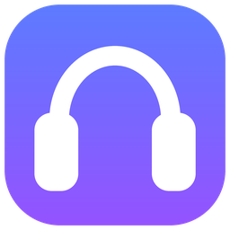

<p align="center">
  
</p>

<h1 align="center">Mini Soundpad</h1>

<p align="center">
  免费开源的 Windows 音效板：按快捷键播放音效，让 Discord / 游戏 / 会议里的人也能听到。
  <br/>
  <a href="README.md">English</a> · <b>简体中文</b>
</p>

---

## 功能

- 🎧 **双路输出**：音效同时在你的耳机里和**虚拟麦克风**里播放，两边音量可以分开调
- 🎙 **麦克风直通**：你的真实麦克风也会混进虚拟麦克风，开着音效板照样能正常说话
- ⌨️ **全局快捷键**：程序在后台、你在游戏里也能触发。再按一次同一个键 = 从头播放
- 🔀 **快捷键选音效**：用快捷键上下切换选中的音效（耳机里会试听开头，别人听不到），再一键播放，不用切出游戏
- 📁 **音效库**：拖入文件或整个文件夹，支持改名、分类、搜索，每个音效单独设音量
- ⏺ **录音 / 内录**：从麦克风录，或者录下电脑正在播放的声音（视频里的一句台词之类）
- ✂️ **剪辑**：在波形上拖动选范围，试听后另存为新文件，原文件不动
- 🖥 **托盘运行**：点 ✕ 会缩到右下角托盘，后台继续工作
- 支持 wav / mp3 / m4a / aac / flac / wma / mp4

## 安装

### 1. 安装虚拟声卡 VB-Audio Virtual Cable（免费）

从 <https://vb-audio.com/Cable/> 下载，解压后**右键 `VBCABLE_Setup_x64.exe` → 以管理员身份运行** → Install Driver → **重启电脑**。

> ⚠️ 装完后 Windows 可能会把默认播放设备改成 "CABLE Input"，导致电脑没声音。点任务栏右下角的 🔊 把输出设备换回你的耳机/音箱就好。

### 2. 下载 Mini Soundpad

到 [**Releases**](../../releases/latest) 下载最新的 `MiniSoundpad-vX.Y.Z-win-x64.zip`，解压后双击 `MiniSoundpad.exe` 就能用，不需要安装 .NET。

> 第一次运行时 Windows 可能会弹出"Windows 已保护你的电脑"。这是因为程序没有付费代码签名，点 **更多信息 → 仍要运行** 即可。

### 3. 设置 Discord（或其它语音软件）

用户设置 → 语音和视频：
- **输入设备** 选 **CABLE Output (VB-Audio Virtual Cable)**
- 关掉 **噪音抑制（Krisp）**、**回声消除**、**自动增益控制**，否则音效可能被当成噪音过滤掉
- 关掉"自动确定输入灵敏度"，把滑块拉到最左

然后在 Mini Soundpad 的 ⚙ 设置里确认：「自己听（耳机）」选你的耳机，「真实麦克风」选你的麦克风，并勾选「麦克风直通」。

> 用语音时 Mini Soundpad 要一直开着（可以缩在托盘里），否则别人听不到你说话。

## 默认快捷键

| 功能 | 快捷键 |
|---|---|
| 全部停止 | `Pause` |
| 选上一个音效 | `Ctrl+Alt+PageUp` |
| 选下一个音效 | `Ctrl+Alt+PageDown` |
| 播放选中的音效 | `Ctrl+Alt+Home` |
| 给某个音效设快捷键 | 右键音效 → 设置快捷键… |

都可以在 ⚙ 设置里改。全局快捷键注册后会被本程序独占，所以别用单独的字母键，推荐 `Ctrl+Alt+数字`、小键盘键或 `F13–F24`。

## 工作原理

```
音效 ──┬──► [耳机混音器] ──► 你的耳机                      （你自己听）
       └──► [线缆混音器] ──► CABLE Input ─► CABLE Output ─► Discord / 游戏
                 ▲
真实麦克风 ──────┘（麦克风直通）
```

音效在添加时就解码成 48 kHz 立体声 float 放进内存，所以按键触发几乎没有延迟，同一份数据同时喂给两个混音器。音频部分基于 [NAudio](https://github.com/naudio/NAudio)（WASAPI）。

## 从源码编译

需要 [.NET 8 SDK](https://dotnet.microsoft.com/download/dotnet/8.0)。

```powershell
git clone https://github.com/cywang06/MiniSoundpad.git
cd MiniSoundpad
dotnet run
```

打包成单个 exe：

```powershell
dotnet publish -c Release -r win-x64 --self-contained true -p:PublishSingleFile=true -o publish
```

### 代码结构

```
Audio/
  AudioEngine.cs     核心：两个混音器（耳机 / 虚拟线缆）+ 麦克风直通
  CachedSound.cs     音频预解码进内存 + Voice（一次播放）
  AudioUtil.cs       格式转换、重采样、设备枚举、自动识别 VB-Cable
  Recorder.cs        麦克风录音 / WASAPI 内录
Services/
  HotkeyManager.cs   Win32 RegisterHotKey 全局快捷键
  TrayIcon.cs        托盘图标
  Storage.cs         JSON 读写（%AppData%\MiniSoundpad）
Models/Models.cs     SoundItem / Hotkey / AppSettings
Views/               主窗口、设置、快捷键、录音、剪辑（含波形控件）
```

### 发布新版本

把 `MiniSoundpad.csproj` 里的 `<Version>` 改大（比如 `0.3.0`），推送到 `main`。GitHub Actions 发现还没有 `v0.3.0` 这个版本，就会自动编译 exe、打标签并发布到 Releases。

## 数据存放位置

`%AppData%\MiniSoundpad\`：`library.json`（音效列表）、`settings.json`（设置）、`Sounds\`（录音和剪辑生成的文件）、`log.txt`（运行日志，出问题时有用）。

## 已知限制

- 麦克风直通会增加约 20–60 ms 延迟（WASAPI 共享模式），通话中基本察觉不到
- 内录在没有声音播放时不写数据，静音段会被跳过
- 暂不支持 .ogg
- 拔插音频设备后，需要在设置里点一次保存来重新打开设备

欢迎提 Issue 和 Pull Request！

## 许可证

[MIT](LICENSE)
